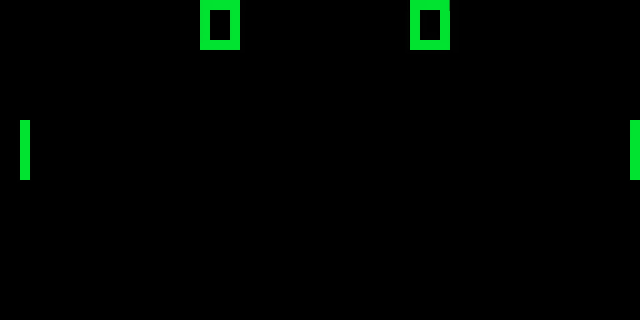

# ft_chip8
A simple chip-8 emulator written in Rust using macroquad.

## Description
CHIP-8 is a simple interpreted programming language and virtual machine originally designed in the 1970s for developing small games. It features a simple architecture with 4 KB of memory, 16 registers, a 64×32 monochrome display, and a 16-key hexadecimal keyboard.

This project implements a CHIP-8 emulator in Rust using Macroquad, allowing CHIP-8 ROMs to be loaded and executed.

23 (public domain) ROMs are included in the roms directory.



## Requirements

- [Rust](https://www.rust-lang.org/tools/install) (stable toolchain, installed with `rustup`)
- On Linux, the system libraries required by macroquad:
```bash
  sudo apt install pkg-config libx11-dev libxi-dev libgl1-mesa-dev libasound2-dev
```

## Build

```bash
cargo build --release
```

The executable is generated in `target/release/`.

## Usage

Run the emulator with a CHIP-8 ROM:

```bash
cargo run --release -- <rom>
```

Or directly with the compiled binary:

```bash
./target/release/chip8 <rom>
```

Example:

```bash
cargo run --release -- roms/PONG
```

## Controls

The CHIP-8 hexadecimal keypad is mapped to the left side of a QWERTY keyboard:

```
CHIP-8 keypad        Keyboard
1 2 3 C              1 2 3 4
4 5 6 D      →       Q W E R
7 8 9 E              A S D F
A 0 B F              Z X C V
```

Press `Escape` to quit.

## Author

psykokwak13 — CHIP-8 emulator